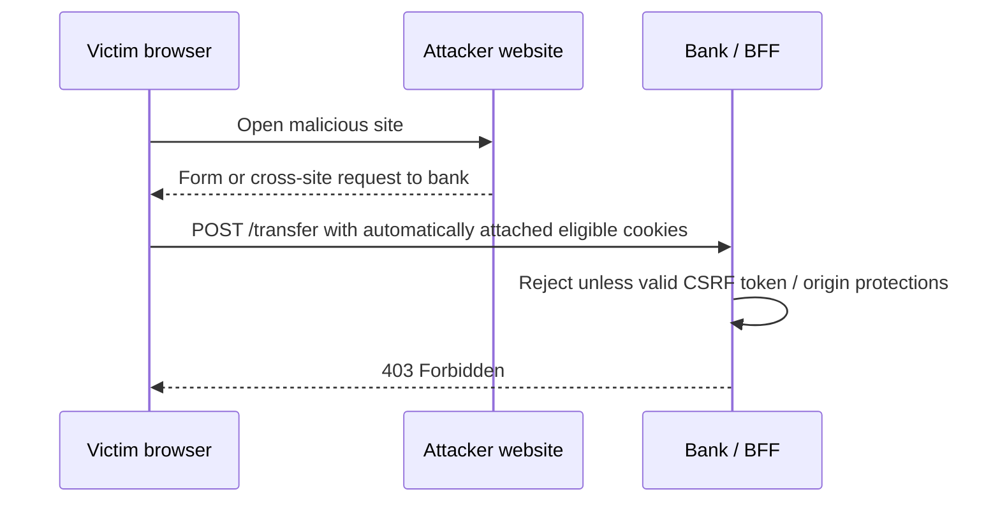

# OAuth 2.0, OpenID Connect, PKCE and Token Lifecycle

> Senior Java / Hands-on Team Lead interview notes. Architecture shown: **confidential Backend-for-Frontend (BFF)** with a server-side session. A browser-only SPA has a different token-storage model.

## 1. Mental model

| Component | Responsibility |
|---|---|
| Browser | Follows redirects; sends session cookie to BFF |
| OAuth Client / BFF | Initiates login, validates callback, stores tokens server-side |
| Authorization Server (AS) / OpenID Provider (OP) | Authenticates user, issues code and tokens, publishes JWKS |
| Resource Server (Spring Boot API) | Validates access token and enforces permissions |
| Identity token (ID token) | OIDC assertion of authentication **to the client** |
| Access token | Authorization credential **for the resource server** |
| Refresh token | Credential used **only with AS token endpoint** to obtain new access token |

OAuth 2.0 is an authorization framework. **OIDC adds an authentication layer** on top of OAuth 2.0; request `scope=openid`. Access tokens need not be JWTs (they can be opaque).

## 2. Authorization Code + PKCE + OIDC login

```mermaid
sequenceDiagram
    autonumber
    participant U as Browser
    participant C as OAuth Client / BFF
    participant A as Authorization Server / OIDC Provider
    participant R as Spring Boot Resource Server

    U->>C: GET /login
    C->>C: Generate state, nonce, code_verifier
    C->>C: code_challenge = BASE64URL(SHA256(code_verifier))
    C-->>U: 302 redirect to AS /authorize
    U->>A: /authorize?response_type=code&scope=openid...&state=...&nonce=...&code_challenge=...&code_challenge_method=S256
    A->>U: Login / consent (as applicable)
    A-->>U: 302 redirect_uri?code=...&state=...
    U->>C: GET /callback?code=...&state=...
    C->>C: Verify state against stored login transaction
    C->>A: POST /token: authorization_code + code_verifier + redirect_uri + client authentication (if applicable)
    A->>A: Validate code, client and PKCE
    A-->>C: access_token, id_token, optionally refresh_token
    C->>C: Validate ID token signature, iss, aud, exp, nonce
    C->>C: Store tokens server-side; establish user session
    C-->>U: Set-Cookie: session=...; HttpOnly; Secure; SameSite=...
    U->>C: GET /products with session cookie
    C->>R: Authorization: Bearer ACCESS_TOKEN
    R->>R: Verify JWT signature + iss, aud, exp, authorization
    R-->>C: 200 data
    C-->>U: 200 data
```

Notes:
- **state** correlates authorization request and callback; helps prevent login/authorization-response CSRF.
- **nonce** binds an ID token to this OIDC authentication request and mitigates replay/substitution.
- **PKCE** binds authorization code redemption to the initiating client: `code_verifier` stays with client; `code_challenge` goes in authorization request. PKCE is **not JWT signing**.
- Confidential clients authenticate to the token endpoint according to their registration; PKCE is still recommended.
- Validate redirect URI precisely; authorization code is short-lived and one-time.
- Refresh token issuance depends on provider policy and scopes (often `offline_access`, but not universal).
- BFF avoids exposing OAuth tokens to browser JavaScript. The browser's session cookie introduces **CSRF considerations**.

## 3. JWT signature and JWKS: private versus public keys

```mermaid
sequenceDiagram
    participant A as Authorization Server
    participant B as BFF
    participant R as Resource Server
    A->>A: Sign JWT with AS PRIVATE key (e.g. RS256)
    A-->>B: Access token (JWT)
    B->>R: Authorization: Bearer JWT
    R->>A: GET /.well-known/jwks.json (initially / on rotation)
    A-->>R: PUBLIC verification keys (JWKS)
    R->>R: Select key by trusted algorithm + kid; verify signature
    R->>R: Validate issuer, audience, expiry, permissions
    R-->>B: Response or 401/403
```

- The private signing key **never** goes to the API. JWKS exposes public verification keys.
- JWT header `kid` identifies a candidate key; do not blindly trust attacker-controlled `alg` or URLs.
- Signature verification ensures integrity/authenticity, **not confidentiality**. JWT payload is normally readable.
- `401 Unauthorized`: absent/invalid authentication. `403 Forbidden`: authenticated but insufficient permission.
- JWT validation does not automatically make tenant/resource authorization correct.

## 4. Refresh token rotation and expiry

```mermaid
sequenceDiagram
    participant U as Browser
    participant C as BFF
    participant A as Authorization Server
    participant R as API
    U->>C: Request with session cookie
    C->>C: Access token expired / near expiry
    C->>A: POST /token grant_type=refresh_token + refresh_token
    A->>A: Validate refresh token; rotate if configured
    A-->>C: New access token; possibly new refresh token
    C->>C: Atomically replace stored tokens
    C->>R: Bearer NEW_ACCESS_TOKEN
    R-->>C: API response
    C-->>U: Response
```

- Refresh token is **not** sent to the resource API.
- If refresh fails (revoked/expired/reuse detected), clear session and require new login.
- Rotation requires careful concurrency handling (multiple requests trying to refresh simultaneously).
- A client can refresh proactively; not every flow must wait for a 401.

## 5. CSRF, CORS, cookies and bearer tokens



- **CSRF** exploits browser-automatically-attached credentials (typically cookies). Mitigate with CSRF tokens, appropriate SameSite cookies, Origin/Referer checks as defense in depth.
- **CORS** controls browser access to cross-origin responses and certain requests; it is **not a substitute for CSRF protection**.
- An API receiving an explicit `Authorization: Bearer` header, with no ambient browser credential, is generally not susceptible to classic cookie-based CSRF; **XSS/token theft** remains a concern.
- If JWT is stored in an automatically attached cookie, CSRF is relevant again.
- OIDC `state` and application CSRF tokens protect **different request boundaries**.

## 6. Spring Boot resource-server example

```java
@Configuration
@EnableWebSecurity
@EnableMethodSecurity
class SecurityConfig {
    @Bean
    SecurityFilterChain securityFilterChain(HttpSecurity http) throws Exception {
        return http
            .authorizeHttpRequests(auth -> auth
                .requestMatchers("/actuator/health").permitAll()
                .anyRequest().authenticated())
            .oauth2ResourceServer(oauth -> oauth.jwt(Customizer.withDefaults()))
            .build();
    }
}
```

```yaml
spring:
  security:
    oauth2:
      resourceserver:
        jwt:
          issuer-uri: https://auth.example.com/realms/app
          audiences:
            - orders-api
```

The API validates JWT issuer and audience; configure claims-to-authorities mapping for your token format. The example is for a **bearer-token API**; do not copy its CSRF defaults blindly into a cookie-session BFF.

For multi-tenant applications, `hasRole('ADMIN')` alone is insufficient: check membership, permission **within the active tenant**, and resource ownership. Apply tenant filters consistently at the data layer.

## 7. Interview answers (English)

**OAuth2 vs OIDC?**  
"OAuth 2.0 is an authorization framework. OpenID Connect adds authentication and an ID token so the client can verify who signed in."

**What is PKCE?**  
"PKCE prevents an intercepted authorization code from being redeemed by an attacker. The client sends a challenge during authorization and proves possession of the verifier during token exchange."

**How does the API validate JWT?**  
"The resource server retrieves the issuer's public signing keys from JWKS, verifies the signature and checks expiry, issuer, audience and the permissions required by the endpoint."

**How do refresh tokens work?**  
"The OAuth client exchanges a refresh token at the authorization server for a new access token. Refresh token rotation and secure storage reduce replay risk. The refresh token is never used as an API bearer token."

**Does JWT eliminate CSRF?**  
"No. CSRF depends on how credentials are attached. A JWT sent automatically in a cookie can be vulnerable; an explicitly attached Authorization header typically avoids classic CSRF, though XSS is still important."

## 8. Common traps

1. Sending ID token to an API as an access token.
2. Assuming every OAuth2 access token is JWT.
3. Confusing PKCE verifier/challenge with signing keys.
4. Trusting a JWT without checking `aud`, `iss`, `exp` and signature.
5. Treating roles in JWT as sufficient proof of resource ownership.
6. Sending refresh tokens to a resource server.
7. Treating CORS as CSRF protection.
8. Assuming `SameSite` alone solves every CSRF scenario.
9. Forgetting refresh-token concurrency and revocation.
10. Disabling CSRF protection in a cookie-session BFF without a replacement.

## 9. Quick recall checklist

**Login:** state + nonce + PKCE → redirect → code → verify state → token exchange → validate ID token → session.  
**API:** access token → JWKS public key → verify signature/claims → authorization/tenant check.  
**Refresh:** refresh token → AS token endpoint → new access (possibly rotated refresh).  
**Security:** private signing key stays with AS; browser cookie requires CSRF defenses.

## 10. References

- OAuth 2.0 Authorization Framework: https://www.rfc-editor.org/rfc/rfc6749
- PKCE (RFC 7636): https://www.rfc-editor.org/rfc/rfc7636
- OAuth 2.0 Security Best Current Practice (RFC 9700): https://www.rfc-editor.org/rfc/rfc9700
- OpenID Connect Core: https://openid.net/specs/openid-connect-core-1_0.html
- JWT (RFC 7519): https://www.rfc-editor.org/rfc/rfc7519
- Spring Security OAuth2 Resource Server: https://docs.spring.io/spring-security/reference/servlet/oauth2/resource-server/jwt.html
